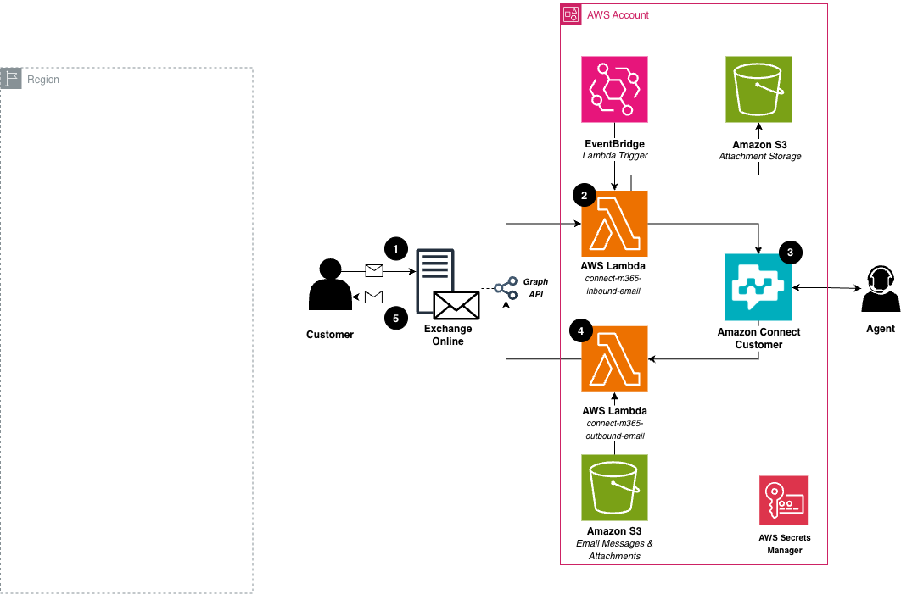

# Route Microsoft 365 Email Through Amazon Connect Customer

Companion code for the AWS Contact Center blog post [Route Microsoft 365 Email Through Amazon Connect Customer](BLOG_POST_URL) by Mark Macdonald, Ritesh Khanna and Nathan McCourt.

This sample keeps customer email in your Microsoft 365 (Exchange Online) mailbox while agents work the email in Amazon Connect Customer. Two AWS Lambda functions use the Microsoft Graph API: one brings unread mail into Amazon Connect Customer as email contacts, the other sends agent replies back out through Exchange Online. Conversation threading is preserved through standard email headers, with no database.

> **This is sample code, for non-production usage.** You should work with your security and legal teams to meet your organizational security, regulatory and compliance requirements before deployment.

> **Third-party service.** This code interacts with Microsoft 365 (Exchange Online) and Microsoft Graph, which have terms published at [Microsoft APIs Terms of Use](https://learn.microsoft.com/en-us/legal/microsoft-apis/terms-of-use) and pricing described at [Microsoft 365 plans and pricing](https://www.microsoft.com/en-us/microsoft-365/enterprise/microsoft365-plans-and-pricing). You should be familiar with the pricing and confirm that your use case complies with the terms before proceeding.

## Contents

- [Architecture](#architecture)
- [How threading works](#how-threading-works)
- [What gets deployed](#what-gets-deployed)
- [Before you deploy](#before-you-deploy)
- [Step 1: Register an app in Microsoft Entra ID](#step-1-register-an-app-in-microsoft-entra-id)
- [Step 2: Limit the app to one mailbox](#step-2-limit-the-app-to-one-mailbox)
- [Step 3: Deploy the stack from AWS CloudShell](#step-3-deploy-the-stack-from-aws-cloudshell)
- [Step 4: Add your Microsoft 365 credentials](#step-4-add-your-microsoft-365-credentials)
- [Step 5: Assign the outbound whisper flow](#step-5-assign-the-outbound-whisper-flow)
- [Step 6: Test](#step-6-test)
- [Troubleshooting](#troubleshooting)
- [Security design](#security-design)
- [Known limitations](#known-limitations)
- [Production considerations](#production-considerations)
- [Cost](#cost)
- [Clean up](#clean-up)

## Architecture



- **Inbound.** An Amazon EventBridge schedule invokes the inbound function every few minutes (default 5). It reads unread messages from the mailbox Inbox through Microsoft Graph, stages attachments in a private Amazon S3 bucket (shared with Amazon Connect Customer through 1-hour presigned URLs), embeds small inline images in the body, and calls `StartEmailContact`. It then marks the message as read.
- **Outbound.** When an agent sends a reply, the outbound whisper flow created by this stack invokes the outbound function. It reads the reply and its attachments from your Amazon Connect Customer email storage, builds a MIME message, and sends it through Microsoft Graph, so the email leaves through Exchange Online. It then calls `StopContact` so Amazon Connect Customer does not also send a copy through Amazon Simple Email Service (Amazon SES).

The integration works with Microsoft 365 (Exchange Online) only. Threading relies on Exchange Online keeping the custom `Message-ID` header this sample sets on replies. Google Workspace (Gmail) overwrites that header.

## How threading works

The Amazon Connect Customer contact ID travels in standard RFC 5322 headers, so no lookup table is needed. The design solves two separate problems.

**Linking contacts inside Amazon Connect Customer.** The outbound reply's `Message-ID` is set to `<ContactId@your-mailbox-domain>`. A mail client that replies copies that value into `In-Reply-To`, so the contact ID comes back on its own. The inbound function extracts it with a regular expression that only matches `<UUID@your-mailbox-domain>` and, if the reply's sender matches the customer on that earlier contact, passes it as `RelatedContactId` on `StartEmailContact`. A reply from a different address starts a new, unlinked contact.

**Nesting the reply in the customer's inbox.** A customer's mail client nests a reply only when `In-Reply-To` and `References` point at a message the client already has, which is the customer's own original email. The inbound function forwards the customer's real `Message-ID` to Amazon Connect Customer, which exposes it as the `connect:EmailMessageId` segment attribute. The outbound function puts that value in `In-Reply-To` and `References`.

| Outbound header | Value | Purpose |
|-----------------|-------|---------|
| `Message-ID` | `<ContactId@your-mailbox-domain>` | Comes back as `In-Reply-To`, becomes `RelatedContactId` |
| `In-Reply-To`, `References` | The customer's original `Message-ID` (`connect:EmailMessageId`) | Nests the reply under the customer's email |

The outbound function finds the original `Message-ID` from the contact's segment attribute first, then with up to two `DescribeContact` calls (the related contact, then the initial contact). If it can't find one, the reply still sends as a new thread.

The MIME message is serialized with CRLF line endings. A bare `\n` after a quoted-printable soft line break makes Exchange Online insert stray `=` characters into the delivered body.

### Inline images

Inline images, such as pasted screenshots and signature logos, are embedded in the message body as `data:` URIs, the same format Amazon Connect Customer uses for images an agent adds. Images larger than `INLINE_IMAGE_MAX_MB` (default 2 MB) are delivered as regular attachments.

## What gets deployed

| Resource | Purpose |
|----------|---------|
| Inbound Lambda function `connect-m365-inbound-email-<stack-name>` | Polls the mailbox and starts email contacts |
| Outbound Lambda function `connect-m365-outbound-email-<stack-name>` | Sends agent replies through Microsoft 365 |
| Amazon Connect Customer flow `Email - Outbound Whisper - M365 (<stack-name>)` | Invokes the outbound function when an agent replies |
| Amazon Connect Customer Lambda integration | Lets your instance invoke the outbound function |
| AWS Secrets Manager secret (generated name) | Holds the Microsoft Entra ID app credentials and mailbox address |
| AWS KMS customer managed key | Encrypts the secret, dead-letter queue, log groups and function environment variables, with automatic rotation |
| Amazon S3 attachments bucket (generated name) | Stages inbound attachments, private, TLS only, versioned, objects deleted after 30 days |
| Amazon S3 access logs bucket (generated name) | Server access logs for both buckets, private, TLS only, deleted after 90 days, kept when the stack is deleted |
| Amazon EventBridge rule | Polling schedule |
| Amazon SQS dead-letter queue | Receives schedule events that could not be delivered and failed asynchronous invocations |
| Two IAM roles | One per function, scoped to the resources above |
| Two Amazon CloudWatch Logs log groups | One per function, 30-day retention |

## Before you deploy

- [ ] An Amazon Connect Customer instance with the [email channel set up](https://docs.aws.amazon.com/connect/latest/adminguide/setup-email-channel.html), in the AWS account and Region you will deploy to.
- [ ] CORS configured on the instance's email storage S3 bucket (`amazon-connect-...`), as described in [Enable attachments](https://docs.aws.amazon.com/connect/latest/adminguide/enable-attachments.html). Without it the agent workspace shows "Failed to get email message".
- [ ] An Amazon Connect Customer email address for this integration, for example `support@<instance-alias>.email.connect.aws`. It is separate from your Microsoft 365 mailbox address: customers write to the Microsoft 365 mailbox, and the inbound function uses the Amazon Connect Customer address as the contact's destination.
- [ ] A published inbound email flow that sets a working queue, and its flow ID.
- [ ] An email queue that has an outbound email address set.
- [ ] A dedicated Microsoft 365 mailbox for this integration. The inbound function only picks up unread mail in the Inbox, so anyone else reading the mailbox can hide messages from it.
- [ ] Permission to create an app registration in Microsoft Entra ID, and the Exchange Administrator role (or membership of Organization Management) for Step 2.
- [ ] AWS permissions to deploy an AWS CloudFormation stack that creates IAM roles, Lambda functions and Amazon Connect resources (including `connect:CreateContactFlow` and `connect:CreateIntegrationAssociation`), and access to AWS CloudShell.

## Step 1: Register an app in Microsoft Entra ID

The functions sign in to Microsoft Graph as an application (client credentials flow), with no signed-in user.

1. In the [Microsoft Entra admin center](https://entra.microsoft.com), go to **App registrations** and choose **New registration**. See [Register an application](https://learn.microsoft.com/en-us/entra/identity-platform/quickstart-register-app).
2. Name it `Connect Customer Email Integration`, choose **Single tenant**, leave **Redirect URI** empty, and choose **Register**.
3. On the **Overview** page, copy the **Application (client) ID** and **Directory (tenant) ID**.
4. Under **Certificates & secrets**, choose **New client secret**, pick a short expiry, and copy the secret **Value** immediately. It is shown only once.

Do not add API permissions yet. Step 2 decides how the app gets mail access.

## Step 2: Limit the app to one mailbox

The functions need two Microsoft Graph application permissions: **Mail.ReadWrite** (read unread mail, download attachments, mark as read, create the reply draft) and **Mail.Send** (send the draft). Choose **one** of these paths. Never use both: permissions granted in Microsoft Entra ID apply to every mailbox in the tenant and are added on top of any Exchange scope.

### Path A (recommended): Exchange Online RBAC for Applications

The app gets mail access to the integration mailbox only. It has no Microsoft Graph API permissions in Microsoft Entra ID. See [Role Based Access Control for Applications in Exchange Online](https://learn.microsoft.com/en-us/exchange/permissions-exo/application-rbac).

1. Install the ExchangeOnlineManagement PowerShell module and connect with `Connect-ExchangeOnline`. See [Connect to Exchange Online PowerShell](https://learn.microsoft.com/en-us/powershell/exchange/connect-to-exchange-online-powershell).
2. In the Microsoft Entra admin center, open **Enterprise applications**, select `Connect Customer Email Integration`, and copy its **Application ID** and **Object ID**. Use the Enterprise applications page, not App registrations, which shows a different object ID.
3. Run the following, replacing the placeholders:

   ```powershell
   New-ServicePrincipal -AppId <application-id> -ObjectId <enterprise-app-object-id> -DisplayName "Connect Customer Email Integration"

   New-ManagementScope -Name "Connect Customer Email Integration mailbox" `
     -RecipientRestrictionFilter "PrimarySmtpAddress -eq 'support@yourdomain.com'"

   New-ManagementRoleAssignment -App <enterprise-app-object-id> -Role "Application Mail.ReadWrite" `
     -CustomResourceScope "Connect Customer Email Integration mailbox"

   New-ManagementRoleAssignment -App <enterprise-app-object-id> -Role "Application Mail.Send" `
     -CustomResourceScope "Connect Customer Email Integration mailbox"
   ```

4. Check the scope. The first command should show `InScope` as `True` for both roles, and the second, against any other mailbox, should show `False`:

   ```powershell
   Test-ServicePrincipalAuthorization -Identity <enterprise-app-object-id> -Resource support@yourdomain.com
   Test-ServicePrincipalAuthorization -Identity <enterprise-app-object-id> -Resource someone.else@yourdomain.com
   ```

Exchange can take some time to apply new role assignments. If the first test emails fail with an authorization error, wait and try again.

### Path B (quick start only): Microsoft Entra ID permissions

This path lets the app read and send mail as **every mailbox in your tenant**. Use it only in a test tenant.

1. In the app registration, go to **API permissions**, choose **Add a permission**, **Microsoft Graph**, **Application permissions**, and add `Mail.ReadWrite` and `Mail.Send`.
2. Choose **Grant admin consent**.

Make sure you add them as **Application** permissions, not Delegated. Delegated permissions need a signed-in user and don't work here.

## Step 3: Deploy the stack from AWS CloudShell

Open [AWS CloudShell](https://console.aws.amazon.com/cloudshell/) in the **same Region as your Amazon Connect Customer instance**. CloudShell includes git and the AWS SAM CLI, and the functions have no third-party dependencies, so no build step is needed.

```bash
git clone https://github.com/aws-samples/sample-enterprise-email-integration-for-amazon-connect.git
cd sample-enterprise-email-integration-for-amazon-connect
sam deploy --guided --capabilities CAPABILITY_IAM
```

Answer the prompts:

| Prompt | What to enter |
|--------|---------------|
| Stack Name | A short name, for example `connect-m365-email`. It is added to resource names. |
| AWS Region | The Region of your Amazon Connect Customer instance |
| ConnectInstanceArn | Your instance ARN, from the instance page in the Amazon Connect console |
| InboundContactFlowId | The ID of your inbound email flow (the last part of the flow ARN) |
| DestinationEmailAddress | Your Amazon Connect Customer email address for this integration |
| ConnectStorageBucketName | Optional. Your instance's email storage bucket name, to limit the outbound function to that bucket. Press Enter to allow any `amazon-connect-` bucket in the account. |
| ConnectStorageKmsKeyArn | Optional. The KMS key ARN that encrypts that bucket, to limit decryption to that key. Press Enter to skip. |
| BatchSize | Press Enter for 10 |
| PollingIntervalMinutes | Press Enter for 5 |
| ReserveInboundConcurrency | Press Enter for `true`. See [Troubleshooting](#troubleshooting) if deployment fails on concurrency. |
| Confirm changes before deploy | `Y` |
| Allow SAM CLI IAM role creation | `Y` |
| Disable rollback | `N` |
| Save arguments to configuration file | `N` |

The SAM CLI uploads the function code to an S3 bucket it manages (stack `aws-sam-cli-managed-default`) and creates the stack. When it finishes, it prints the stack outputs. Keep them for the next steps.

To deploy from your own machine instead, install the [AWS CLI](https://docs.aws.amazon.com/cli/latest/userguide/getting-started-install.html) and the [AWS SAM CLI](https://docs.aws.amazon.com/serverless-application-model/latest/developerguide/install-sam-cli.html), configure credentials for the account, and run the same commands.

## Step 4: Add your Microsoft 365 credentials

The stack creates the secret with placeholder values. Until you replace them, both functions log `M365 secret not configured` and do nothing else.

1. Open the `SecretsManagerSecretConsoleUrl` stack output (or find the secret in the Secrets Manager console by the `SecretsManagerSecretArn` output).
2. Choose **Retrieve secret value**, then **Edit**, and set:

   ```json
   {
     "tenant_id": "<directory-tenant-id>",
     "client_id": "<application-client-id>",
     "client_secret": "<client-secret-value>",
     "mailbox_email": "support@yourdomain.com"
   }
   ```

3. Save.

Use the console rather than a CLI command, so the client secret is not saved in your shell history. `mailbox_email` is the From address on replies, and its domain is used in the threading `Message-ID`.

## Step 5: Assign the outbound whisper flow

The stack created and published `Email - Outbound Whisper - M365 (<stack-name>)`, already wired to the outbound function.

1. In the Amazon Connect admin website, go to **Routing**, **Queues**, and open the queue that handles this email.
2. Under **Outbound email configuration**, set **Outbound email flow** to `Email - Outbound Whisper - M365 (<stack-name>)` (the `OutboundWhisperFlowName` output), and save.

## Step 6: Test

1. From a personal mail account, send an email with an attachment to your Microsoft 365 mailbox.
2. Within one polling interval, accept the email contact in the agent workspace. Check the From, To, Subject, body and attachment.
3. Reply as the agent. Check the reply arrives from your Microsoft 365 address, nested under your original email.
4. Reply again from your personal account and accept the new contact. It should show the earlier messages as one conversation.

## Troubleshooting

| Symptom | Check |
|---------|-------|
| Deployment fails with `decreases account's UnreservedConcurrentExecution below its minimum value` | Your account's Lambda concurrency quota is low. Redeploy with `ReserveInboundConcurrency` set to `false`, or request a quota increase. With `false`, keep the polling interval longer than the time one poll takes. |
| No contacts appear | Inbound function log group: look for `M365 secret not configured`, token errors, or a Graph `error.code` such as `ErrorAccessDenied` (scope or consent missing, see Step 2). Confirm the message is unread and in the Inbox. |
| Agent workspace shows "Failed to get email message" | CORS on the instance's email storage bucket, see [Before you deploy](#before-you-deploy). |
| Agent replies never arrive | Outbound function log group, and that the queue's outbound email flow is the stack's flow (Step 5). The function returns `status` and a short `reason` code to the flow. |
| Customer replies start a new conversation | The reply came from a different address than the original email, or the customer's mail client dropped `In-Reply-To`. |

Log groups are `/aws/lambda/connect-m365-inbound-email-<stack-name>` and `/aws/lambda/connect-m365-outbound-email-<stack-name>`.

## Security design

- **Credentials.** The Microsoft Entra ID client secret is stored only in AWS Secrets Manager. Each function role can read only that secret. Nothing secret is in environment variables or logs. The sample uses client-secret authentication; rotate the secret before it expires by creating a new one in Microsoft Entra ID and updating the Secrets Manager value.
- **Mailbox scope.** Path A in Step 2 limits the app to one mailbox. Path B is tenant-wide.
- **Threading.** The inbound function does not link a reply to an earlier contact when the reply's sender differs from that contact's customer address, so a forged `In-Reply-To` header cannot pull a message into another customer's conversation.
- **Encryption.** A customer managed AWS KMS key, with automatic rotation, encrypts the secret, the dead-letter queue, both log groups and both functions' environment variables. Its key policy lets IAM grant access in your account, and lets CloudWatch Logs and EventBridge use it only for this stack's log groups and queue.
- **Attachments bucket.** Private (Block Public Access, bucket owner enforced), TLS only, encrypted with SSE-S3, versioned, with server access logging. Objects are deleted after 30 days, and replaced or deleted versions after 1 day, so versioning does not keep extra copies of attachments for long. Amazon Connect Customer reads attachments through presigned URLs that expire after 1 hour.
- **Access logs bucket.** Receives server access logs for the attachments bucket and for itself (under `self/`). Private, TLS only, SSE-S3 (the only encryption S3 log delivery supports), logs deleted after 90 days.
- **IAM.** One role per function, scoped to this stack's resources and your instance. The outbound function's access to email storage can be limited to one bucket and one KMS key with the optional parameters. The Lambda permission for Amazon Connect is limited to your instance ARN.
- **Outbound connections.** The functions connect only over HTTPS, and only to `login.microsoftonline.com`, `graph.microsoft.com` and AWS endpoints.
- **Logging.** Logs record contact IDs, Microsoft Graph message IDs, counts and status codes, never subjects, addresses, file names or message content. Amazon Connect Customer stores the subject and addresses on the contact by design, and flow logs record the Lambda exchange.
- **Scanner exceptions.** The template records each security scanner check it does not meet, with the reason, in the resource's `Metadata`. They are: VPC placement for both functions, and a dead-letter queue and reserved concurrency for the synchronously invoked outbound function.

## Known limitations

- **Microsoft 365 only.** Google Workspace overwrites the `Message-ID` header that threading relies on.
- **Failed replies are not retried.** If the outbound function fails after the agent sends (for example a Graph error or the 8-second flow limit), the contact is still stopped, so Amazon Connect Customer does not send the reply through Amazon SES either. The reply is not delivered and the agent is not told. Monitor the outbound function's errors (see [Production considerations](#production-considerations)).
- **Fallback reply text.** If the outbound function cannot read the agent's reply body from storage, it sends "Thank you for your email." in its place.
- **8-second flow limit.** Amazon Connect Customer allows the outbound function 8 seconds. Large attachments or slow Graph responses can exceed it, and the flow then ends on its error branch.
- **Possible duplicate send.** If the outbound function fails after Microsoft Graph accepts the send, a retry could send the reply twice.
- **Polling order and failures.** Each poll takes the newest unread messages first, up to `BatchSize`. A message that always fails stays unread and is retried on every poll, and a large backlog can delay older mail.
- **Inbox only.** Mail that rules move to other folders, and mail in Junk Email, is not picked up.
- **Inline images** over `INLINE_IMAGE_MAX_MB` arrive as attachments.
- **Attachment size.** Microsoft Graph and Amazon Connect Customer size limits apply to attachments in both directions.
- **Ten attachments per inbound email.** The inbound function processes the first 10 attachments of each email; any more are not passed to Amazon Connect Customer.
- **Microsoft Graph throttling.** The functions do not back off and retry when Graph throttles requests. See [Microsoft Graph throttling](https://learn.microsoft.com/en-us/graph/throttling-limits).
- **Email storage bucket name.** Unless you set `ConnectStorageBucketName`, the outbound function assumes your instance's email storage bucket name starts with `amazon-connect-`.

## Production considerations

- Alarm on errors for both functions and on messages in the dead-letter queue.
- Use certificate or federated credentials for the Microsoft Entra ID app instead of a client secret. This needs a code change to the token request.
- Rotate the client secret on a schedule.
- Run the functions in a VPC with a NAT gateway if your network policy requires it.
- Add retry with backoff for Microsoft Graph throttling, and size limits for attachments.
- Review Exchange Online Protection or Microsoft Defender settings for the mailbox. This sample does not scan attachments.

## Cost

You pay for the AWS resources this stack creates, on top of your Amazon Connect Customer charges. See [Amazon Connect pricing](https://aws.amazon.com/connect/pricing/) for email contact charges.

- **Lambda.** The inbound function runs at every polling interval, even when there is no new mail. Shorter intervals mean more invocations. Test volumes usually stay within the AWS Free Tier.
- **Secrets Manager.** One secret, billed per month.
- **AWS KMS.** One customer managed key, billed per month, plus requests.
- **Amazon S3.** Attachment storage (deleted after 30 days), access logs (deleted after 90 days), plus the small bucket the SAM CLI uses for deployment artifacts.
- **EventBridge, Amazon SQS and CloudWatch Logs.** Small at sample volumes.

Use the [AWS Pricing Calculator](https://calculator.aws/) for your Region and volume. Your Microsoft 365 licensing is separate.

## Clean up

1. In the Amazon Connect admin website, set the email queue's outbound email flow back to its previous value.
2. Empty the attachments bucket (the `InboundAttachmentsBucketName` output) in the Amazon S3 console. The console's **Empty** action also removes old versions.
3. In CloudShell, from the repository folder, run `sam delete --stack-name <stack-name>`. This removes the functions, flow, secret, roles, log groups, queue and attachments bucket, and schedules the KMS key for deletion after 7 days.
4. The access logs bucket (the `AccessLogsBucketName` output) is kept as an audit record, and its logs expire after 90 days. To remove it, wait a day for the last log deliveries, then empty and delete it in the Amazon S3 console.
5. Optionally, if no other stack uses it, delete the SAM CLI's `aws-sam-cli-managed-default` stack and its bucket.
6. In the Microsoft Entra admin center, delete the `Connect Customer Email Integration` app registration. If you used Path A, also remove the management role assignments, management scope and service principal in Exchange Online.

Deleting the stack schedules the secret for deletion after its recovery window. The secret name is generated, so you can deploy again straight away.

## Security

See [CONTRIBUTING](CONTRIBUTING.md#security-issue-notifications) for more information.

## License

This library is licensed under the MIT-0 License. See the [LICENSE](LICENSE) file.
